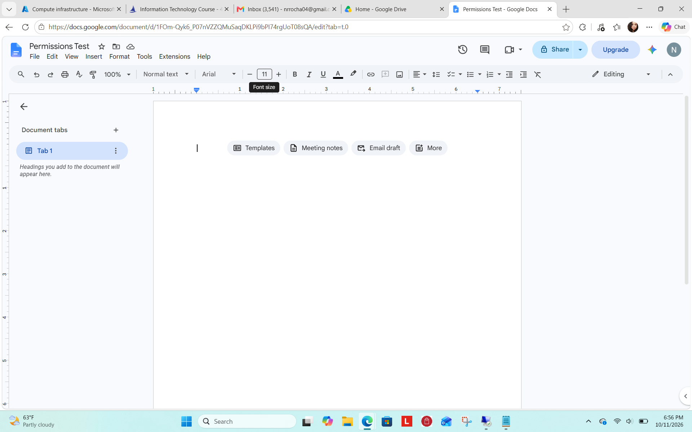
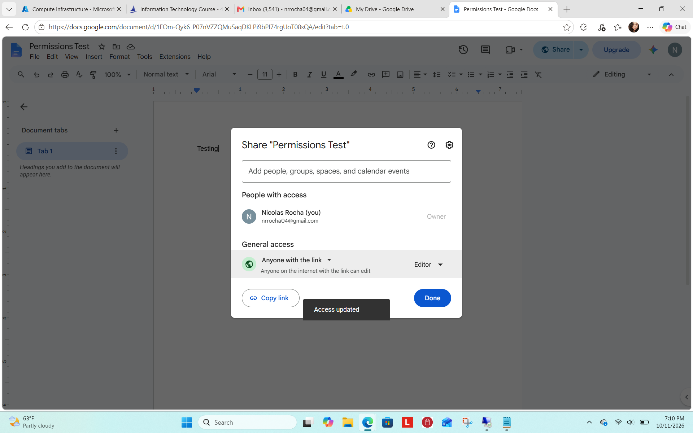
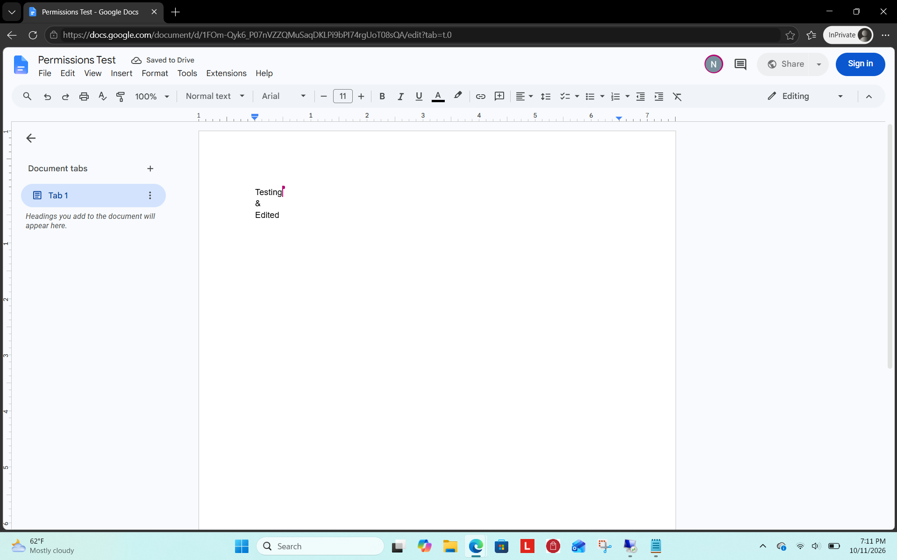
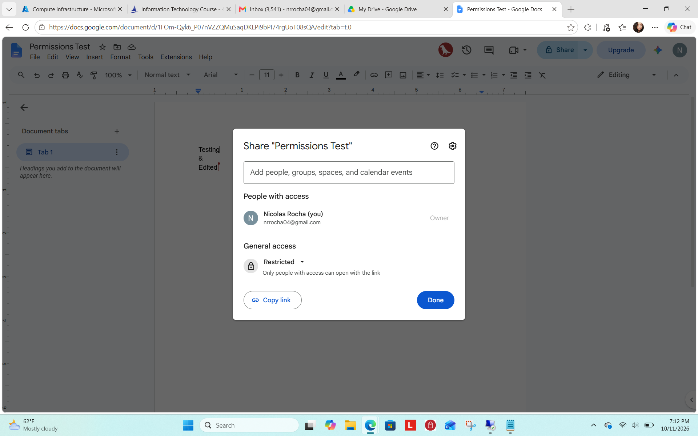
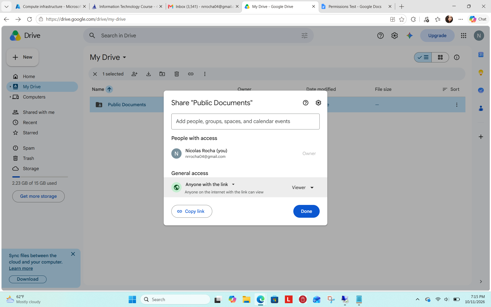
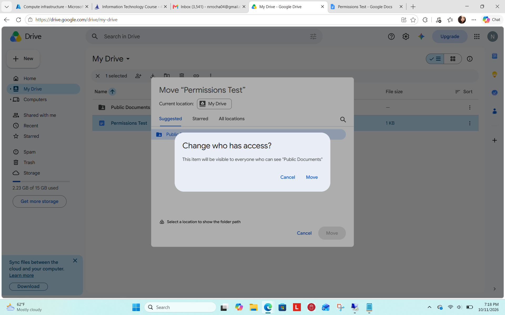
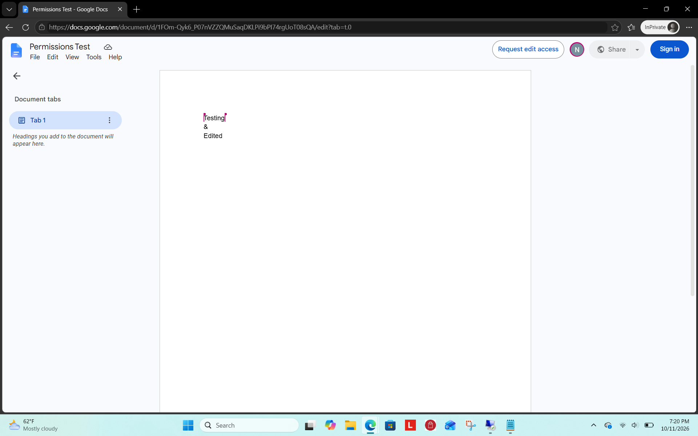

# Google Drive – File Sharing & Permissions Lab

## Overview

In this lab, I explored Google Drive file sharing, access permissions, and folder permission inheritance. I practiced configuring document permissions, testing access through a private browser window, and observing how moving a restricted document into a shared folder affects accessibility.

## Environments and Technologies Used

- Google Drive
- Google Docs
- Microsoft Edge (InPrivate Browsing)
- Google Workspace sharing permissions

## Objectives

- Create a Google Docs document
- Test document accessibility using InPrivate browsing
- Configure public editing permissions
- Verify editing access
- Restore restricted permissions
- Create a publicly viewable folder
- Observe folder permission inheritance
- Verify inherited access using InPrivate browsing

## Lab Steps

### Step 1: Create a Google Docs Document

Created a new Google Docs document named **Permissions Test** to use throughout the lab.

### Step 2: Test Document Access in InPrivate Browsing

Opened the document in a Microsoft Edge InPrivate window to test how it could be accessed outside my regular signed-in browser session.

The document displayed with a **Request edit access** option, indicating that editing was not available in this session.

### Step 3: Configure Public Editor Permissions

Opened the document's sharing settings and configured:

- **General Access:** Anyone with the link
- **Role:** Editor

This allowed users with the document link to make changes.

### Step 4: Verify Editing Permissions

Returned to the InPrivate browser window and tested editing the document.

Successfully added text to verify that public editing permissions were functioning.

### Step 5: Restore Restricted Access

Returned to the document's sharing settings and changed General Access back to **Restricted**.

This removed general link-based access and limited document access to authorized users.

### Step 6: Create a Public Documents Folder

Created a folder named **Public Documents** in Google Drive.

Configured the folder's sharing settings:

- **General Access:** Anyone with the link
- **Role:** Viewer

This allowed users with the folder link to view its contents without granting editing permissions.

### Step 7: Test Folder Permission Inheritance

Moved the restricted **Permissions Test** document into the **Public Documents** folder.

Google Drive displayed a notification indicating that the document would become visible to users who could access the shared folder.

Confirmed the move to observe how folder sharing affected the document's accessibility.

### Step 8: Verify Inherited Access

Opened the document again using Microsoft Edge InPrivate browsing.

Successfully accessed and viewed the document after moving it into the publicly shared folder.

The **Request edit access** option indicated that the document was viewable without granting general editing privileges.

## Lab Results

- Created and managed a Google Docs document
- Configured public editing permissions
- Tested document editing through InPrivate browsing
- Restored restricted access
- Created a publicly viewable Google Drive folder
- Observed folder permission inheritance
- Verified document accessibility after moving it into the shared folder

## Skills Demonstrated

- Cloud file management
- Access control and permission management
- Google Drive administration
- File and folder sharing
- Permission inheritance
- Security and access verification
- Troubleshooting document accessibility

## Conclusion

This lab provided hands-on experience managing cloud-based file permissions and understanding how folder sharing can affect document accessibility.

These skills are relevant to IT help desk and technical support roles, where technicians frequently assist users with shared documents, access restrictions, and file permission issues.
